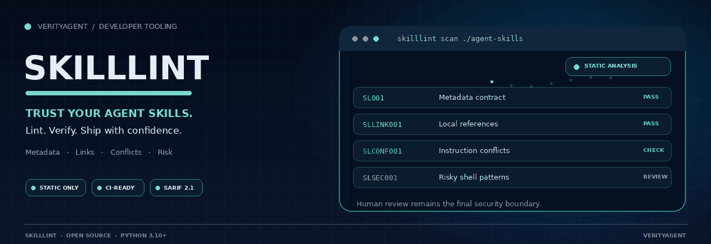
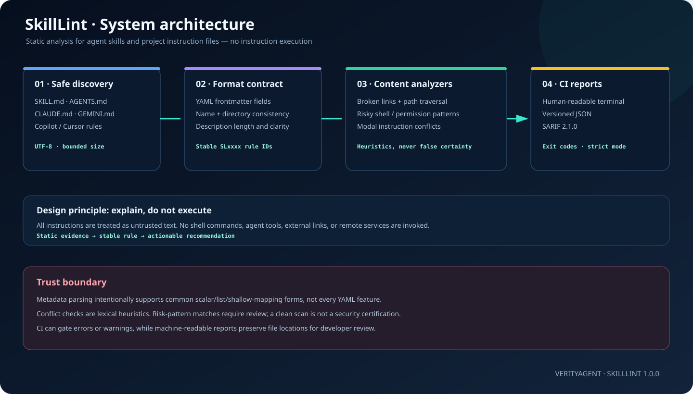
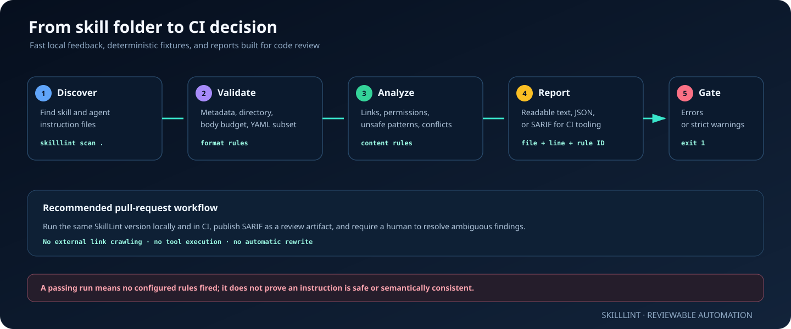
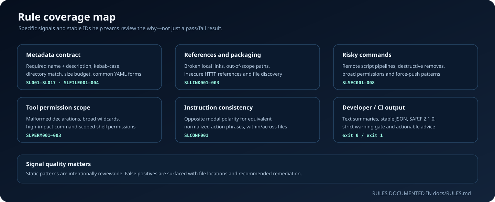
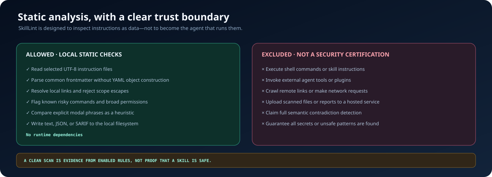

# SkillLint

  

  <strong>Find broken, conflicting, and risky AI-agent skills before they reach your workflow.</strong> 
  A static-analysis CLI for Agent Skills, SKILL.md metadata, AGENTS.md, CLAUDE.md, GEMINI.md, Cursor rules, Copilot instructions, and other supported instruction files.

  <a href="#quick-start">Quick start</a> ·
  <a href="#visual-system-guide">Visual system</a> ·
  <a href="docs/RULES.md">Rule catalogue</a> ·
  <a href="SECURITY.md">Security boundaries</a>

  
  
  
  
  
  

> **VerityAgent open-source developer tooling.** SkillLint is an early release: the rules below describe implemented static checks, not a promise of perfect semantic understanding or security certification.

## The problem

An AI coding-agent skill is executable influence even when its file is plain Markdown: metadata may be malformed, linked resources can be missing, tool access can be excessively broad, and project instructions can disagree. A typo or conflict can quietly derail an agent. A dangerous command example can be copied into a trusted workflow.

SkillLint checks common failure modes before an instruction file is committed or installed. It reads instructions as **untrusted text**. It does not run their commands, call agent tools, fetch remote links, or upload report content.

## At a glance

| Trust signal | What it means |
| --- | --- |
| **Static only** | No instruction text, code block, or shell command is executed by the scanner. |
| **Zero runtime dependencies** | The CLI uses Python's standard library; Pillow is only needed to regenerate the animated README GIF. |
| **CI-ready** | Non-zero exit on errors; optional strict mode also fails on warnings. |
| **Machine-readable** | Stable JSON output plus SARIF 2.1.0 results with file and line locations. |
| **Explainable checks** | Findings carry rule IDs, a short explanation, evidence when safe to include, and a remediation recommendation. |
| **Portable tests** | Test fixtures use temporary files and a bundled sample skill; no API key or external server is required. |

## Quick start

Requires Python 3.10 or newer.

~~~bash
git clone https://github.com/muhammadsaeed-ai/verity-SkillLint.git
cd verity-SkillLint
python -m pip install -e .
~~~

Run it against a skill directory:

~~~bash
skilllint scan examples/changelog-auditor
~~~

Scan a repository for supported instruction files:

~~~bash
skilllint scan .
~~~

Fail the run when warnings exist as well as errors:

~~~bash
skilllint scan . --strict
~~~

Produce JSON for scripts or SARIF for CI review tooling:

~~~bash
skilllint scan . --format json --output skilllint-report.json
skilllint scan . --format sarif --output skilllint-report.sarif
~~~

Install the development tools and run the tests:

~~~bash
python -m pip install -e ".[dev]"
python -m pytest
ruff check src tests
python -m build
~~~

## Visual system guide

The repository includes hand-authored SVG explainers and a reproducible animated hero. The diagrams are actual files committed to the repository—not external screenshots.

### 1. Architecture: files in, explainable findings out

Discovery finds supported skill and instruction files while excluding common generated folders. Metadata, links, permissions, risky command patterns, and explicit conflicting instructions are checked using separate modules. The renderer then produces a reviewable report with stable rule IDs.

### 2. Developer workflow

Run SkillLint locally during skill authoring, then run the same command in CI. Use strict mode when a team wants warnings to block a merge. Review heuristic findings rather than treating all pattern matches as authoritative.

### 3. Rule coverage map

The documented families cover metadata contract, packaging links, dangerous shell patterns, permissions, and opposite modal statements that normalize to the same action phrase. The detector intentionally avoids claiming full natural-language reasoning.

### 4. Security boundary

A clean scan means no enabled rules reported an issue. It does **not** establish that the skill is safe, that every secret was found, or that two semantically different instructions cannot conflict. See the [security policy](SECURITY.md).

## Rules and outputs

Read the full catalogue in [docs/RULES.md](docs/RULES.md). Current rule groups include:

| Rule family | Examples |
| --- | --- |
| Metadata contract | Missing frontmatter, duplicate fields, invalid name format, missing description, unsupported YAML subset |
| File budget | Skill length and large-file safety limits |
| Local references | Missing file links, relative paths escaping the scanned scope, insecure HTTP links |
| Risk patterns | Remote scripts piped to a shell, destructive recursive deletion, world-writable permissions, force pushes |
| Permission scope | Invalid allowed-tools shape, broad wildcards, high-impact shell permissions |
| Instruction conflicts | Opposite modal polarity for the same normalized action phrase |
| CI output | Text, JSON, SARIF 2.1.0, strict exit mode |

### Exit behavior

- Exit code <code>0</code> when there are no errors and strict mode is not triggered.
- Exit code <code>1</code> when an error is present, or when <code>--strict</code> is enabled and warnings exist.
- CLI usage or report-write failures return a non-zero status.

## Configuration and compatibility

SkillLint discovers the following instruction formats when scanning a directory:

- <code>SKILL.md</code> Agent Skills and companion reference links
- <code>AGENTS.md</code>, <code>CLAUDE.md</code>, <code>GEMINI.md</code>, and <code>CODEX.md</code>
- <code>.github/copilot-instructions.md</code> and <code>*.instructions.md</code>
- <code>.cursor/rules/*.mdc</code>
- <code>.windsurfrules</code>, <code>.clinerules</code>, and <code>.cursorrules</code>

Run against one file to narrow the scope, or add repeatable <code>--exclude GLOB</code> patterns when scanning a repository:

~~~bash
skilllint scan . --exclude "vendor/**" --exclude "docs/legacy/**"
~~~

The frontmatter parser intentionally supports common scalar, list, block-text, and shallow-mapping forms. It does not attempt to implement all YAML syntax. Unsupported constructs are reported rather than guessed or executed. Links are checked locally; external sites are not fetched.

## CI integration

A ready-to-adapt workflow is included at <code>.github/workflows/skilllint-example.yml</code>. It runs on pull requests that touch instruction files and saves a SARIF report artifact.

~~~yaml
- name: Install SkillLint
  run: python -m pip install .
- name: Lint agent instructions
  run: skilllint scan . --strict --format sarif --output skilllint-report.sarif
~~~

For stricter organizations, choose which warnings are merge-blocking. If you later connect SARIF to code-scanning features, check the permissions and availability of those features in your GitHub plan and repository settings.

## Project layout

~~~text
src/skilllint/
├── frontmatter.py   # conservative metadata parser
├── links.py         # local Markdown and HTML references
├── security.py      # risky command and permission patterns
├── conflicts.py     # explicit opposite-modal heuristic
├── skills.py        # Skill metadata and quality rules
├── scanner.py       # file discovery, budgets, orchestration
├── reporters.py     # terminal, JSON, and SARIF
└── cli.py           # CLI and exit behavior

tests/                # deterministic parser, rule, CLI, and report tests
examples/             # a complete reference skill
assets/readme/        # animated hero and architecture explainers
docs/                 # rule catalogue and architecture
~~~

## Contributing

Bug reports, additional deterministic rules, better false-positive handling, and format compatibility fixes are welcome. Read [CONTRIBUTING.md](CONTRIBUTING.md) before opening a pull request.

## License

MIT. See [LICENSE](LICENSE).

## Topics

<code>ai-agent-skills</code> · <code>agent-skills</code> · <code>skilllint</code> · <code>claude-skills</code> · <code>agent-instructions</code> · <code>prompt-engineering</code> · <code>ai-coding-agents</code> · <code>static-analysis</code> · <code>security-lint</code> · <code>github-actions</code> · <code>SARIF</code> · <code>developer-tools</code>

Built and maintained under VerityAgent · founded by Mohammed Saeed

